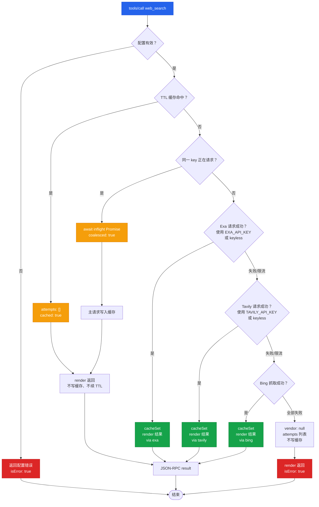

# websearch-ring

[](https://github.com/TWFU-wcy/websearch-ring/actions/workflows/ci.yml)
[](https://github.com/TWFU-wcy/websearch-ring/releases)
[](LICENSE)

**多后端轮询 · 自动故障转移 · Keyless 优先** 的网页搜索 MCP Server。

一份 `index.js`，零 npm 依赖，接到任意支持 **stdio MCP** 的客户端即可稳定联网搜索——不绑模型、不绑厂商、不强制 API Key。

```text
3 results for "杭州周末天气" (via exa, cached)
1. 杭州天气预报…
   https://…
```

首行标明实际来源（`via exa` / `tavily` / `bing`），以及是否命中缓存（`, cached`）或被并发合并（`, shared with a concurrent call`）。

---

## 为什么需要它

| 痛点 | websearch-ring 的做法 |
|------|------------------------|
| 单一搜索 API 挂了 / 限流 | 按环顺序自动换下一家 |
| 不想管一堆 API Key | 默认 keyless 通道开箱即用 |
| 同样 query 被子代理打爆 | 有界 TTL 缓存 + 相同并发请求合并 |
| 长驻进程内存越用越多 | LRU 容量上限 + 周期清理，缓存不会无限增长 |
| 出站带用户标识 | **请求不携带任何用户标识** |
| 换模型后内置 websearch 不可用 | 独立 stdio MCP，客户端无关 |

---

## 特性

- ✅ **厂商轮盘**：默认 `exa → tavily → bing`，失败 / 超时 / 限流自动 failover
- ✅ **Keyless 优先**：可选 `EXA_API_KEY` / `TAVILY_API_KEY` 提额度
- ✅ **有界 TTL 缓存**：默认 20 分钟（`WEBSEARCH_TTL_MS`）+ 容量上限（`WEBSEARCH_CACHE_MAX`，默认 512 条，LRU 淘汰）+ 周期过期清理
- ✅ **并发合并**：相同 query 并发只打一次后端
- ✅ **支持取消**：`notifications/cancelled` 会真正中止上游请求，且不写入缓存
- ✅ **并发有界**：`WEBSEARCH_MAX_INFLIGHT`（默认 16）限制同时打到厂商的请求数，超出排队而非拒绝
- ✅ **响应体限长**：上游响应封顶 5MB，异常/被劫持的上游无法耗尽内存
- ✅ **配置严格校验**：数值型变量非法时给出明确错误（变量名、收到的值、期望格式），不会被「全部厂商失败」吞掉
- ✅ **可审计**：via 来源 + 失败 attempts + 截断标记 + stderr 上的缓存命中/容量诊断
- ✅ **单文件**：约 870 行有效代码，无构建、无 dependencies

---

## 快速开始

### 1. 测试（可选）

```bash
npm test                          # 确定性单测：47 项，不联网，全绿才算通过
node smoke-test.mjs --offline     # 离线冒烟：initialize / tools/list / 参数校验 / 取消
node smoke-test.mjs "杭州周末天气"  # 完整冒烟：真联网搜索 + 缓存断言
```

冒烟测试对每个响应做**真实断言**（响应 id 匹配、`content[0].text` 非空且格式正确、错误路径返回正确错误码、stdout 只有 JSON-RPC 帧），任何一条不满足即 `exit 1` 并打印原因。

关于缓存断言：测试**先等第一个搜索返回，再发一个参数完全相同的请求**，断言首行为 `(via …, cached)`，并断言服务端 stderr 里 `vendor … served` 只出现一次（上游没有被重复访问）、出现 `cache hit for …`。

> 注意区分两个标记:同一批次（未等返回）连发相同请求走的是 inflight 合并，首行是 `shared with a concurrent call`；只有**前一次已经返回**的相同请求才会命中缓存并显示 `, cached`。

### 2. 接入（两种通用方式）

路径改成你机器上的绝对路径。

**方式 A — CLI（例：Claude Code）**

```bash
claude mcp add websearch-ring -- node /absolute/path/to/websearch-ring/index.js
```

**方式 B — 通用 `mcpServers` JSON**  
（Claude Desktop、Cursor 等；Codex 等 TOML 客户端把同样字段改成对应格式即可）

```json
{
  "mcpServers": {
    "websearch-ring": {
      "command": "node",
      "args": ["/absolute/path/to/websearch-ring/index.js"],
      "env": {
        "WEBSEARCH_VENDORS": "exa,tavily,bing",
        "WEBSEARCH_TIMEOUT_MS": "12000",
        "WEBSEARCH_TTL_MS": "1200000",
        "WEBSEARCH_MAX_CHARS": "12000",
        "WEBSEARCH_CACHE_MAX": "512"
      }
    }
  }
}
```

任何支持 **command + args + env** 的 MCP 客户端都是同一套路。

---

## 环境变量（全部可选）

| 变量 | 默认 | 合法范围 | 说明 |
|------|------|----------|------|
| `WEBSEARCH_VENDORS` | `exa,tavily,bing` | `exa` / `tavily` / `bing` 的逗号列表 | 轮转顺序；未知名字视为配置错误 |
| `WEBSEARCH_TIMEOUT_MS` | `12000` | 整数 1–600000 | 单厂商超时 |
| `WEBSEARCH_MAX_CHARS` | `12000` | 整数 1–10000000 | 返回文本上限 |
| `WEBSEARCH_TTL_MS` | `1200000` | 整数 0–2592000000 | 缓存 TTL；`0` 关闭缓存 |
| `WEBSEARCH_CACHE_MAX` | `512` | 整数 1–100000 | 缓存条目上限（超出按 LRU 淘汰）；默认 512 条时约 512 × 8KB ≈ 4MB |
| `WEBSEARCH_MAX_INFLIGHT` | `16` | 整数 1–256 | 同时进行的厂商请求数上限；超出的查询**排队等待**（stderr 提示），不报错 |
| `EXA_API_KEY` | （空） | — | 空则 keyless |
| `TAVILY_API_KEY` | （空） | — | 空则 keyless |
| `WEBSEARCH_UA` | Chrome UA | 非空字符串 | Bing 抓取 UA |

**数值型变量严格校验**，三种情况行为确定：

1. **未设置 / 仅空白** → 用默认值；
2. **合法值** → 生效；
3. **非法值**（`12s`、`1.5`、`0x10`、超范围、负数等）→ 回落到默认值，**并且**服务器在 stderr 和每一次 `tools/call` 的返回里给出明确错误，例如：

```text
websearch-ring is misconfigured, so no search was performed. Fix the environment variable(s) below and restart the MCP server:
- WEBSEARCH_TIMEOUT_MS="12s" is not a valid number: expected an integer between 1 and 600000 (received "12s").
```

配置错误时 `initialize` / `tools/list` / `ping` 仍正常工作，只是不会发起任何搜索——这样错误一定能被调用方看到，而不是伪装成「全部厂商失败」。

---

## 调用流程



要点：

1. **优先级**：缓存命中 → inflight 合并 → 新跑轮转（不可颠倒）
2. **缓存命中**：不写缓存、不续 TTL；`attempts: []` + `cached: true` 直接 `render`，并在 stderr 打印 `cache hit for … (entries n/max)`（可观测性）
3. **仅厂商成功** 时 `cacheSet`；合并方与全失败都不写
4. **缓存有界**：超过 `WEBSEARCH_CACHE_MAX` 按 LRU 淘汰最久未用的条目（stderr 打印淘汰日志）；过期条目除了在访问时删除，还有 `unref()` 定时器（TTL/4，1–60 秒）周期清理，进程不会因此被拖住
5. **取消**：`notifications/cancelled` 会 abort 对应请求的上游 fetch，清理 inflight 记录，**不写缓存也不回包**；并发合并时**只有发起取消的调用方失败**，其余等待方继续拿到结果；stdin 关闭时**等待在途请求回包后再退出**（one-shot pipe 友好）
6. **全失败**：正常返回 `vendor: null` + `attempts`，仍走 `render`，`isError: true`
7. **标记**：`cached` > `coalesced`（shared）> 空；有失败才出 Note 行
8. **配置错误**：直接返回配置错误文本（`isError: true`），不进入厂商轮转

---

## 工具接口

**Tool:** `web_search`

| 参数 | 类型 | 必填 | 说明 |
|------|------|------|------|
| `query` | string | ✅ | 搜索词，非空、去首尾空格、最长 1000 字符 |
| `numResults` | integer | | 默认 8；**非整数向下取整**（`3.7`→`3`）、越界钳制到 1–20（`0`→`1`，`99`→`20`） |

非法输入返回明确的 JSON-RPC 错误，而不是静默替换：

| 情况 | 返回 |
|------|------|
| `query` 缺失 / 非字符串 / 全空白 | `-32602 Invalid params: "query" must be a non-empty string, received …` |
| `query` 超过 1000 字符 | `-32602 Invalid params: "query" is N characters long; the maximum is 1000.` |
| `numResults` 非数字（如 `"3"`、`NaN`） | `-32602 Invalid params: "numResults" must be a finite number, received …` |
| 未知 tool / 未知方法 | `-32602` / `-32601` |
| 请求体不是合法 JSON | `-32700 Parse error`（`id: null`） |
| 全部厂商失败 | 正常响应 + `isError: true` + `Attempts:` 列表 |

---

## 测试与 CI

| 命令 | 内容 | 是否联网 |
|------|------|----------|
| `npm test` | `test/unit.test.mjs`（配置解析、实体解码、厂商解析、缓存淘汰/过期、缓存命中与合并、取消、render、JSON-RPC 错误码）+ `test/server.test.mjs`（真实 stdio 进程：配置错误、协议错误码、取消、import 无副作用、优雅退出） | 否，确定性 |
| `node smoke-test.mjs --offline` | 离线冒烟：协议 + 参数校验 + 取消断言 | 否 |
| `node smoke-test.mjs "query"` | 完整冒烟：真实搜索 + 缓存命中断言 | 是 |

CI 的阻塞 job 只跑前两项（离线、确定性，失败即红灯）；真实联网冒烟是**独立、非阻塞**的 job（`continue-on-error: true`，也可用 `workflow_dispatch` 手动触发），因为 keyless 后端从 CI runner 访问经常失败，不应该决定 CI 红绿。

---

## 与同类方案的差异

1. **最轻**：单文件、零依赖
2. **Keyless-first**，可选补 Key
3. **有界缓存 + 并发合并 + 可取消** 同时具备
4. **via / attempts 透明**，配置错误不会被吞

> **最轻量的高可用搜索环：一份 index.js，`WEBSEARCH_VENDORS` 自定义的厂商顺序自动故障转移 + 有界 TTL 缓存 + 并发合并。**

---

## 许可证

MIT
